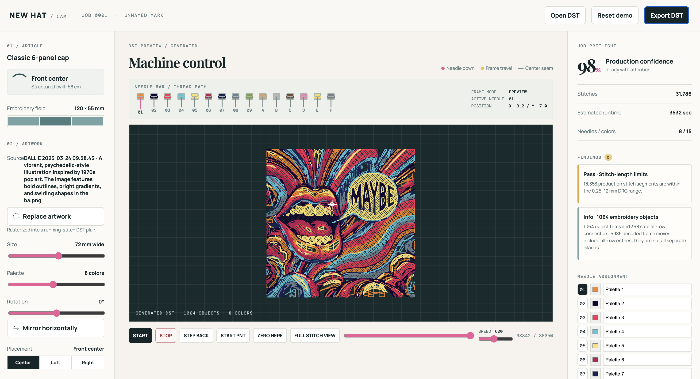

# New Hat digitizer prototype

New Hat converts raster artwork into an inspectable embroidery stitch plan,
simulates the resulting machine path, and exports DST files. It is a
local development prototype intended for review and test stitching, not an
unattended production digitizer.

For a candid, code-aligned description of the current planning decisions,
failure modes, and questions for expert coaching, see
[`docs/digitizing-flow-human-review.md`](docs/digitizing-flow-human-review.md).
The normative craft and engineering standard is
[`docs/world-class-programmatic-embroidery-digitizing-guide.md`](docs/world-class-programmatic-embroidery-digitizing-guide.md).
The executable learning and validation contract is
[`docs/ml-training-and-drc-methodology.md`](docs/ml-training-and-drc-methodology.md).



## Run the UI

The UI and API are served together from the `prototype` directory:

```sh
cd prototype
python3 server.py
```

Open [http://127.0.0.1:8000](http://127.0.0.1:8000) in a browser.

The root page is the basic workspace. The full editable vector workflow is on
[http://127.0.0.1:8000/digitizer.html](http://127.0.0.1:8000/digitizer.html).
On the full page, elongated script artwork is proposed as an editable
calligraphic stroke graph with curved satin rails. The proposal must still be
reviewed before production.

The UI supports:

- Importing PNG, JPEG, WebP, or SVG artwork.
- Changing width, palette size, stitch density, rotation, mirroring, and
  left/centre/right placement on the cap preview.
- Editing a generated layer's display/thread colour and disabling any colour
  layer before previewing or exporting. Disabled layers are omitted from the
  generated DST sequence.
- Inspecting an existing DST file with the stitch simulator.
- Playing, stepping through, or expanding the stitch simulation.
- Adjusting displayed needle colours and names.
- Exporting the generated or imported operation sequence as DST.

When raster artwork is imported, the browser builds one complete layered
pattern. A busy overlay remains visible while the underlay, blocking, detail,
and DST preview are prepared. The preflight panel reports layer and object
counts, stitches per square inch, machine-level jump records, structural and
detail trims, planning limits, and stitch-type-specific findings. Always
review the slow stitch simulation and run a sample on the intended material
before production.

The current UI uses the `standard` digitizing profile. Use the API to select a
material- or product-specific profile until a profile selector is added to the
UI.

### Model-training workspace

Choose **Train model** beside **Replace artwork** to review phase-specific
color-separation, boundary-cleanup, object/stackup, and stitch-construction
brackets. Boundary-cleanup candidates enlarge the posterized result and compare
source-space smoothing against edge-turn density, component noise, retained
negative spaces, silhouette overlap, and the downstream sewout. Each experiment
is generated once per browser session and remains available when switching
between phases, so comparisons do not invoke the planner again.

Completed experiments are staged as one temporary training session. **Export
session** downloads a ZIP containing the source artwork, experiment manifests,
candidate parameters and metrics, complete plans, DST files, posterized
artwork, and virtual-sewout PNGs. The server deletes the staged session after
the ZIP is delivered successfully and preserves it when delivery is interrupted
so the export can be retried. Replacing artwork or explicitly discarding the
session also removes temporary plans and sewouts. Browser navigation does not
clear an active session because the page may remain live in the back/forward
cache.

## Digitizing API

All endpoints are local and accept JSON unless noted otherwise.

### Create a stitch plan

`POST /api/digitize`

```json
{
  "image": "data:image/png;base64,...",
  "width_mm": 72,
  "colors": 6,
  "profile": "structured_cap",
  "density_multiplier": 1.0,
  "posterization_smoothing_px": 0.85,
  "limits": {
    "max_objects": 400,
    "max_trims": 120,
    "detail_max_trims": 250,
    "max_jumps": 600,
    "trims_per_1000_stitches": 2,
    "jumps_per_1000_stitches": 10
  }
}
```

`image`, `width_mm`, and `colors` are required. `profile` is optional and
defaults to `standard`. `density_multiplier` is optional, defaults to `1.0`,
and is clamped to `0.6`–`1.5`. It changes visible blocking density without
removing source geometry. `limits` optionally overrides object, structural
trim, detail-trim, and jump ceilings. Absolute and per-1,000-stitch limits are
both applied; the lower resolved value is reported by DRC.
`posterization_smoothing_px` is optional, defaults to `0`, and is clamped to
`0`–`3`. It smooths the geometry-analysis raster before foreground extraction
and vectorization while preserving the unsmoothed source for the independent
detail scan.

The response contains a semantic plan:

```json
{
  "version": "2.0",
  "dimensions_mm": {"width": 72.0, "height": 42.0},
  "profile": "structured_cap",
  "algorithm": "layered",
  "algorithm_label": "Layered",
  "density_multiplier": 1.0,
  "posterization": {"method": "otsu_alpha", "threshold": 0},
  "palette": ["#153d7a"],
  "layers": [
    {"id": "underlay", "order": 0},
    {"id": "blocking", "order": 1},
    {"id": "detail", "order": 2}
  ],
  "regions": [],
  "operations": [],
  "drc": {}
}
```

`regions` identifies the selected stitch type, parent geometry element,
color-layer order, physical feature measures, and semantic operations.
`operations` is the complete ordered machine sequence. `drc` reports running,
satin, and fill limits; semantic and estimated machine jump records; trim and
color-change counts; object count; occupied design area; stitches per square
inch; short fill-edge rows; local-density variance; planning-budget
violations; corrections; and a 0–100 quality score.
`drc_policy` applies the versioned production/training gate to those measures
and the compiled operation stream, returning `pass`, `review`, or `block`,
whether export is allowed, and the exact hard, conditional, and review rules.

Automatic plans are composed in physical passes:

1. The underlay filter closes small mask gaps and can inset broad support
   silhouettes. Area, estimated width, and long-span criteria decide whether
   an object receives design-level or object-level support.
2. The blocking filter applies guarded binary median cleanup before satin or
   tatami construction. Cleanup is rejected when it changes too much source
   geometry. The operator density control affects this visible construction.
3. The detail filter combines multiscale RGB edges with color complexity,
   edge population, edge density, physical size, and narrow-stroke criteria.
   A flat solid does not automatically receive a detail pass.

Source-derived blocking geometry is never deleted to satisfy DRC limits.
Movement ceilings are warnings and optimization targets. Derived detail is
capped, preventing raster noise from manufacturing unbounded new objects.
Detail trims have their own relaxed allowance.

The response's `posterization.pass_filter_sets` describes the active filters
and aggregate output sizes. `posterization.element_filter_analysis` records
each element's area, estimated width, bounding dimensions, aspect ratio,
geometric edge count, color complexity/entropy, image-edge count/density, pass
eligibility, filter names, and output pixel counts.

Foreground extraction is independent of requested thread colors. Transparent
images use an Otsu threshold over alpha. Opaque multicolor images sample the
border and remove only background-similar pixels, preserving bright authored
white, cream, yellow, and light-blue elements. One-hue marks use a tighter
Otsu silhouette to suppress JPEG fringe. Accent-preserving palette reduction
is used for multicolor work; median-cut shades remain available for one-hue
consolidation. Geometry elements keep stable IDs when they are subdivided into
color layers.

Available profiles:

| Profile | Intended use |
|---|---|
| `standard` | General wearable embroidery; 7 mm maximum stitch length. |
| `structured_cap` | Structured cap fronts; center-out routing and softer fill density. |
| `unstructured_cap` | Softer cap fronts; center-out routing with moderate density. |
| `leather` | Leather, PVC, and similarly puncture-sensitive materials. |
| `high_pile` | Towels, sherpa, fleece, and other pile fabrics requiring more coverage. |
| `non_wearable` | Decorative pieces where longer exposed stitches are acceptable. |

### Preview an operation sequence

`POST /api/preview.dst`

```json
{"operations": [{"kind": "stitch", "x": 0, "y": 0}]}
```

The server compiles the sequence to DST, immediately decodes it, and returns
the decoded operations for a true-format preview. Coordinates are millimetres.
Operation kinds are `stitch`, `jump`, `trim`, and `color`.

### Plan editable vector objects

`POST /api/vector/plan`

Send an editable document with millimetre-coordinate Bézier nodes. Each object
has an `id`, `color`, `stitch_type` (`running`, `satin`, or `tatami`), `closed`
state, and `nodes`. A node contains an anchor (`x`, `y`) plus optional relative
`in_x`, `in_y`, `out_x`, and `out_y` control-handle coordinates.

The advanced geometry fields are:

- `satin_rails`: exactly two open arrays of Bézier nodes. The planner resamples
  them to matched topology, derives the closed perimeter and centerline, and
  scores mean width, width deviation, and inconsistent shortening.
- `boundaries`: closed Bézier loops for tatami. The first loop is normally the
  exterior; additional loops are retained and resolved with even/odd parity,
  allowing holes and islands.
- `element_id`: stable vectorized-element identity. Object identity and
  grouping do not depend on thread color.
- `physical_layer`: an optional physical embroidery grouping independent of
  the authored compositing layer.
- `sequence_order` and `lock_sequence`: optional hard sequencing controls.
- `satin_spacing_mm`, `fill_angle_degrees`, and `underlay_enabled`: physical
  stitch controls that remain editable without changing source geometry.
- `visual_role`, `pull_compensation_mm`, and `join_overlap_mm`: explicit
  construction intent retained through replanning.
- document-level `foundation_enabled`: disables a generic design foundation
  when object-local support is the safer construction.

```json
{
  "width_mm": 72,
  "height_mm": 55,
  "objects": [{
    "id": "letter-a",
    "color": "#153d7a",
    "stitch_type": "satin",
    "closed": true,
    "nodes": [{"x": -8, "y": -2}, {"x": 8, "y": -2},
              {"x": 8, "y": 2}, {"x": -8, "y": 2}],
    "satin_rails": [
      [{"x": -8, "y": -2}, {"x": 8, "y": -2}],
      [{"x": -8, "y": 2}, {"x": 8, "y": 2}]
    ],
    "satin_spacing_mm": 0.4
  }]
}
```

The response returns the normalized editable document and its regenerated,
ordered stitch operations. It also returns:

- `diagnostics`: per-object satin suitability and boundary information;
- `brackets`: production-unit decision evidence for satin width, rail-width
  deviation, width intervals, inside-curve penetration spacing, local
  radius-to-column-width ratio, and course-angle change. Each bracket includes
  its observed value, preferred or blocking range, status, decision, optional
  rail interval, fallback, and safe operator controls;
- `sequence`: the resolved physical object order;
- `neighbors`: reachable same-layer objects and connection distances;
- `composition`: authored layer and overlap relationships.

The same bracket records are embedded in the corresponding object's
`diagnostics.decision_brackets` array. Status is one of `pass`, `near_limit`,
`warning`, `fallback`, or `blocker`. Numeric curve thresholds are initial
engine profiles and should be calibrated with material-specific sew-outs.

In the full digitizer, the **Satin decision brackets** inspector ranks these
records by severity. Selecting a record selects its object, and non-passing
rail intervals are drawn directly between the editable satin rails. The basic
upload, preview, and download workflow remains unchanged.

The operation sequence begins with a design-level center running underlay.
Within each hard compositing and physical layer, the planner uses the neighbor
graph, thread color, explicit order locks, and entry/exit distances to choose a
route. Travel can become a hidden connector only when it is short enough and
lies beneath geometry stitched later; otherwise the planner emits a trim and
jump.

Editing a point, either satin rail, boundary loop, layer, color, or stitch type
does not destructively alter the other source geometry.

### Vectorize a posterized element

`POST /api/vectorize` accepts a background-removed `data:` image and optional
`width_mm`. Transparent sources use alpha; opaque sources use foreground
thresholding and are cropped to their detected content before physical sizing.
Touching posterized colours remain one visual element.

`POST /api/digitize` first consolidates quantized shades into semantic thread
colors. Same-hue clusters are merged only when they are spatially fragmented
like antialiasing or compression noise; coherent regions remain independent
color depth. A single-thread elongated foreground is automatically handed to
the editable stroke planner, and the response includes `document`, paired
`satin_rails`, normalized `constructs`, and the planned operations. The palette
slider is therefore an upper bound, not a request to invent that many thread
colors.

Elongated artwork is treated as a script/stroke proposal. The vectorizer thins
the silhouette into a stroke graph, splits endpoints/junctions/cycles,
preserves the straightest pen continuation through crossings, proposes local
normal rails, applies explicit pull compensation and join overlap, and emits
editable curved satin objects. Sub-satin and registered-mark segments become
running stitch. Long or unstable turns are split rather than falling back to
an irregular fill. Other broad/irregular elements continue through the
boundary-based tatami path.

See
[`docs/bob-evans-script-mark-regression.md`](docs/bob-evans-script-mark-regression.md)
for the coached script-mark fixture and acceptance criteria.
The normalized sewing constructs, coverage routing, and returned economy
metrics are described in
[`docs/sew-graph-and-thread-economy.md`](docs/sew-graph-and-thread-economy.md).

### Export DST

`POST /api/export.dst`

Uses the same `operations` request body as the preview endpoint and returns an
`application/octet-stream` DST download.

### Inspect DST

`POST /api/inspect.dst`

Send raw DST bytes with `Content-Type: application/octet-stream`. The response
is JSON containing the decoded operations used by the simulator.

## Python use

Use the digitizer directly when working within the repository:

```python
from prototype.digitizer import digitize

plan = digitize(
    open("mark.png", "rb").read(),
    width_mm=72,
    colors=6,
    profile="structured_cap",
    density_multiplier=1.1,
)
print(plan.drc())
operations = plan.operations
```

The final criteria pass removes accidental short stitches and subdivides long
non-tie stitches according to the selected profile. Physical area, perimeter,
estimated width, aspect ratio, compactness, and holes drive stitch-type
selection. Suitable paired rails use satin; broad, irregular, or holed
elements use tatami blocking. Per-element filter analysis admits
running-stitch detail only for narrow strokes or sufficiently large,
edge-bearing/color-complex objects. Eligible support masks drive the
design-level foundation and object underlay; flat or tiny objects do not
automatically acquire every pass. The planner then routes same-color objects
to reduce travel.

## Decision-bracket fixture corpus

Generate repeatable DST, decoded sew-out renders, semantic plans, and one
annotated render/JSON record for every decision bracket:

```sh
python3 tools/generate_bracket_fixtures.py --clean
```

The named PNG, JPG, and SVG sources and their production settings live in
`fixtures/bracket-artwork/fixtures.json`. SVG sources are rasterized with
`rsvg-convert` before entering the same automatic digitizing pipeline.

Output is written to `artifacts/bracket-fixtures/`:

- `manifest.json` records source hashes, settings, metrics, failures, and every
  generated artifact;
- `index.html` is the run gallery;
- each fixture directory contains its DST, full decoded sew-out, complete
  plan, quarantined training record, bracket index, fixture manifest, and
  browsable gallery;
- each bracket has a deterministic filename containing its index, object,
  rule, status, and normalized interval where applicable.
- `training-records.jsonl` collects the versioned DRC-labelled records for
  later rights review and corpus construction.

With the local server running, open the gallery at:

```text
http://127.0.0.1:8000/artifacts/bracket-fixtures/index.html
```

The server maps only the generated `artifacts` directory; it does not expose
source artwork or the rest of the repository.

Useful repeatable subsets include:

```sh
python3 tools/generate_bracket_fixtures.py \
  --only bob-evans-script,satin-curves-svg \
  --statuses warning,fallback,blocker
```

Omit `--statuses` to render every bracket, including passes. `--output`,
`--pixels-per-mm`, and `--manifest` allow isolated runs without changing the
fixture definitions.

## Batch directory queue

Process the next batch of new PNG, JPG, JPEG, and SVG files from an inbox:

```sh
python3 tools/process_digitizing_queue.py /path/to/inbox --batch-size 10
```

The default invocation processes one batch. Use `--drain` to process all files
currently waiting, or keep the queue open for later arrivals:

```sh
python3 tools/process_digitizing_queue.py /path/to/inbox \
  --batch-size 10 --watch --poll-seconds 10
```

Files must remain unchanged for `--settle-seconds` (two seconds by default)
before they are eligible. `--recursive` includes nested inbox directories.
Original artwork is read but never moved or modified.

Queue state is stored in `/path/to/inbox/.digitizer-queue/state.json`. A job is
identified by its relative filename and SHA-256 content hash, so restarting
the command does not repeat completed files. Replacing a file with changed
content creates a new job. A queue lock prevents two processors from consuming
the same inbox concurrently. Use `--retry-failed` on a later invocation to try
failed jobs again, or `--force` to deliberately process every eligible file
once during the current invocation.

By default, reports are written beneath
`artifacts/queue-runs/<queue-name>-<queue-id>/`, outside the inbox so generated
PNG renders cannot feed back into the queue. Every source receives the same
DST, decoded sew-out render, semantic plan, decision-bracket records, DRC
evaluation, and fixture gallery as the repeatable corpus. Each batch also
contains:

- `batch-report.json` for automation;
- `batch-report.csv` for review or import;
- `batch-report.html` for a compact DRC table;
- `index.html` for the per-design render gallery.
- `training-records.jsonl` with versioned DRC labels, proposal summaries, and
  provenance. New records are quarantined until rights and expert review are
  explicitly annotated.

The queue root contains a cumulative `index.html` and a `latest.json` pointer.
With the local server running, the command prints browsable
`/artifacts/queue-runs/...` report URLs. Each job is classified as `pass`,
`review`, or `block`; processing failures remain distinct from DRC findings.

Global production settings can be supplied on the command line:

```sh
python3 tools/process_digitizing_queue.py /path/to/inbox --drain \
  --width-mm 110 --colors 4 --profile structured_cap \
  --density-multiplier 0.95 --statuses warning,fallback,blocker
```

`--statuses` limits only which annotated bracket images are rendered; the full
DRC still runs and is preserved in JSON. A file-specific sidecar named after
the complete artwork filename, such as `mark.png.json`, overrides global
settings:

```json
{
  "name": "mark-cap-110mm",
  "width_mm": 110,
  "colors": 2,
  "profile": "structured_cap",
  "density_multiplier": 0.95,
  "pixels_per_mm": 6,
  "statuses": ["warning", "fallback", "blocker"]
}
```

An explicit `--output` path is supported, but it must be outside the input
queue.

## ML corpus and DRC regression

DRC is shared by production reports and the learning loop. Learned components
may propose semantic objects, stitch families, rails, parameters, and sequence
candidates; deterministic geometry, stitch compilation, machine constraints,
DRC, and encoding remain authoritative.

Build a rights-aware corpus from fixture or queue manifests:

```sh
python3 tools/build_ml_corpus.py artifacts/bracket-fixtures \
  --output artifacts/ml-corpus \
  --annotations fixtures/ml-annotations.json \
  --enforce
```

Use
[`fixtures/ml-annotations.example.json`](fixtures/ml-annotations.example.json)
as the annotation template. Unreviewed or rights-unknown examples remain in
`quarantine.jsonl`; they are never silently used as ground truth. Splits are
deterministic by design family rather than by generated file, preventing size,
profile, or revision variants of one mark from leaking across train and test.

Create the initial deterministic DRC baseline from all engineering fixtures:

```sh
python3 tools/build_ml_corpus.py artifacts/bracket-fixtures \
  --output artifacts/ml-baseline --enforce
```

After changing the engine or introducing a candidate model, build its snapshot
and compare it:

```sh
python3 tools/build_ml_corpus.py artifacts/bracket-fixtures \
  --output artifacts/ml-candidate --enforce

python3 tools/check_drc_regression.py \
  artifacts/ml-baseline/drc-regression.jsonl \
  artifacts/ml-candidate/drc-regression.jsonl
```

The command fails on worsened DRC disposition, increased blockers, excessive
quality-score loss, trim/jump-rate regressions, missing held-out examples, or
new blocked examples. `drc-regression.jsonl` includes quarantined engineering
fixtures for deterministic compiler testing; this does not make them eligible
for model training. `test.jsonl` contains only reviewed, rights-eligible
held-out records and may correctly be empty before annotation. See
[`docs/ml-training-and-drc-methodology.md`](docs/ml-training-and-drc-methodology.md)
for supervision tasks, loss boundaries, correction capture, physical sew-out
validation, and promotion gates.

### Sew-out learning iterations

Generate several compiled candidates, train a small surrogate ranker between
iterations, and prepare physical feedback:

```sh
python3 tools/run_sewout_learning_loop.py bobevans.jpg \
  --output artifacts/ml-sewout-loops/bobevans-110mm \
  --iterations 3 --candidates-per-iteration 3 \
  --width-mm 110 --profile structured_cap
```

Every trial contains a DST, decoded render, complete plan, DRC policy result,
and quarantined training record. The experiment root contains a gallery,
`experiment.json`, `training-records.jsonl`, and `feedback.csv`.

Virtual proxy scores optimize deterministic DRC and thread economy; they do
not claim physical improvement. Only non-blocking candidates are recommended
for sew-out. Enter either `overall_score` from 0–100 or the 1–5 registration,
coverage, readability, and softness scores in `feedback.csv`, plus thread
breaks and notes. Then add iterations without losing the ratings:

```sh
python3 tools/run_sewout_learning_loop.py bobevans.jpg \
  --output artifacts/ml-sewout-loops/bobevans-110mm \
  --resume --iterations 2
```

Physical scores receive greater model weight than virtual proxy scores.
The experiment reports controls that are inactive in the current compiler and
controls that produced no changed output under controlled comparisons, keeping
the model from learning from nominal settings that did not affect stitches.

## Verification

Run the digitizer tests with both the repository root and prototype directory
on the Python module path:

```sh
python3 -m unittest discover -s prototype -p 'test_*.py'
```

The test suite includes Otsu foreground extraction, layered-plan generation,
DST encoding/decoding, centerline path extraction, contour and hole handling,
stitch criteria, profile selection, and a QR/pixel-art visual regression when
an optional barcode scanner is available.
